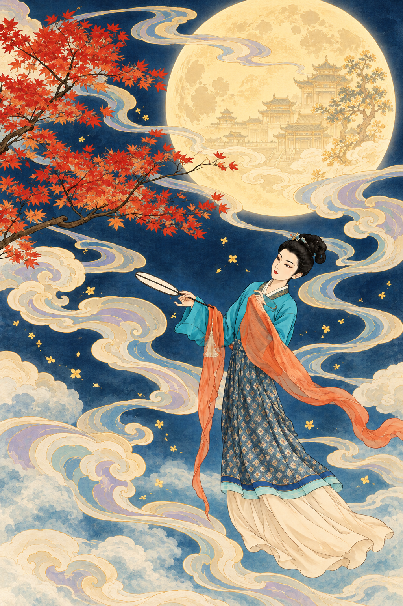
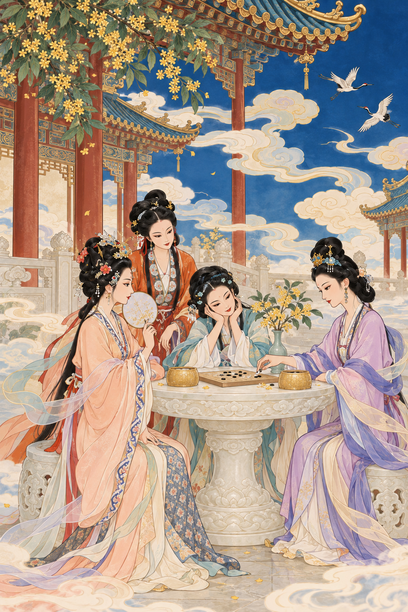

# 青朱古典插画 · Mineral Ink Illustrator

把一句话或人物照片，变成祥云缭绕的天宫幻想插画。

一个面向支持图像生成工具的 Codex 环境的 Skill：以鲜亮的青蓝与朱红配色、细劲勾线、分区平涂和程式化面部，呈现中国古典神话的装饰美感。



## 可以做什么

- **一句话生图**：输入场景内容，自动结合固定画风生成图片。
- **人物照片重绘**：保留人物主体与大致构图，将环境改编为天宫仙境。
- **仙女造型**：按场景调整动作，在原服装基础上增添轻纱、披帛与飘动衣裙。
- **奇幻场景**：搭配祥云、薄雾、海浪、仙鹤、圆月、桂花和少量宫阁，不机械堆满元素。
- **只转换画风**：明确要求保留构图和内容时，只调整绘画语言和配色。

## 画风特点

| 方面 | 视觉特征 |
| --- | --- |
| 人物面部 | 细长眉眼、少量短线概括鼻形、小面积朱红唇、平涂肤色，避免写实面部光影 |
| 轮廓线条 | 深青或深褐细线，轻微粗细变化，圆润舒展的曲线 |
| 配色 | 鲜亮石青、石绿与靛蓝，搭配米白、朱红和橙金，冷暖清楚 |
| 上色 | 分区平涂为主，少量第二色阶阴影与轻层染 |
| 质感 | 哑光纸面、细淡颗粒、轻微颜料沉积，保持轮廓清楚 |

所有人物使用统一的面部绘画语言，但不会复制成同一张脸。成品默认不出现文字、题款、印章、标志或水印。

## 使用环境

需要能加载本地 Skills、且提供可用图像生成工具的 Codex 环境。本 Skill 默认调用宿主内置的 `image_gen`，本身不包含模型、图像服务或 API 密钥；不能独立运行。

图像生成的可用性、耗时和费用由宿主环境决定。实际效果受输入图片和生成模型影响，不能保证像素级保持构图。

## 安装

将本仓库下载后，把包含 `SKILL.md`、`agents/` 与 `references/` 的整个目录命名为 `mineral-ink-illustrator`，放入：

```text
~/.codex/skills/mineral-ink-illustrator/
```

如果设置了自定义 `CODEX_HOME`，则放入对应的 `skills/` 目录。确保 `SKILL.md` 位于技能目录的第一层。安装后在新对话中调用。

也可以把本仓库的 GitHub 地址提供给支持从 GitHub 安装技能的 Skill Installer。

## 调用示例

### 一句话生成

```text
$mineral-ink-illustrator 一位持扇仙女在月桂树下小憩，祥云从枝叶之间穿过。
```

### 上传照片后改绘

```text
使用 $mineral-ink-illustrator 重绘这张图片，保留人物主体与大致构图，生成天宫中的仙女。
```

### 只改变画风

```text
使用 $mineral-ink-illustrator，只使用这张图片中的内容，保持构图、人物动作和服装不变，只改变画风，颜色鲜艳一些，不添加新的元素。
```

### 多人聚会

```text
使用 $mineral-ink-illustrator，参考照片中的人物站位，生成四位仙女在天宫围案对弈的场景。
```

当次明确提出的保留要求优先于默认的天宫改编。例如可以要求严格保留姿势，或不要月亮、不要建筑。

## 场景示例



示例为本技能创作过程中的生成结果，用于展示风格，不代表每次生成都相同。

## 文件说明

```text
mineral-ink-illustrator/
├── SKILL.md                   # 核心指令与生成流程
├── agents/openai.yaml         # 技能显示名称与默认调用提示
├── references/face-style.png  # 面部绘画方式参考
├── examples/                  # README 示例图片
└── README.md                  # 仓库介绍与使用方式
```

面部参考只用于学习线条与设色，不复制其中人物的身份、发饰、角度或表情。
